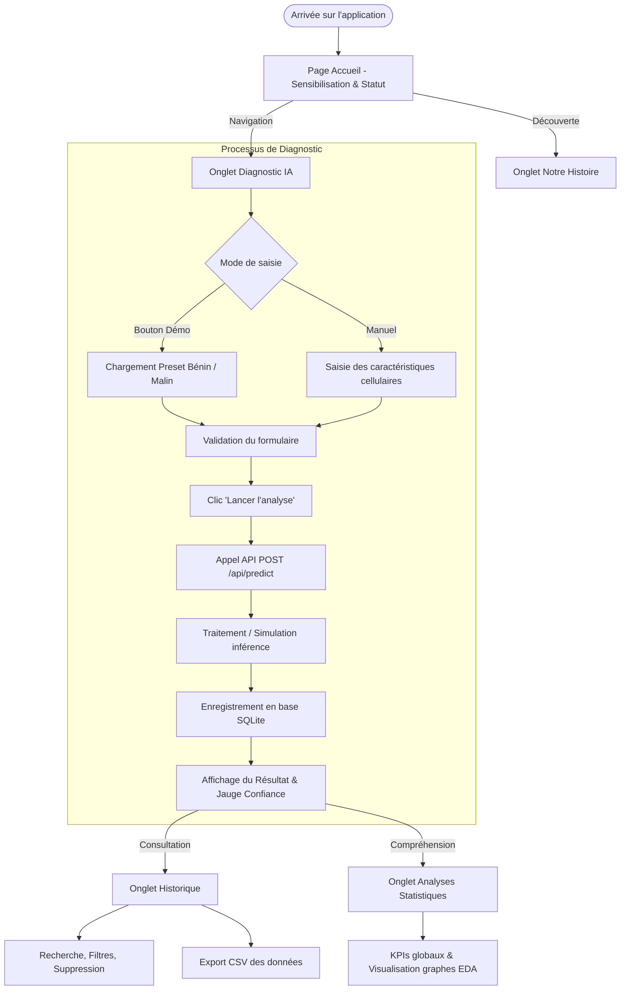

# Documentation Générale de l'Interface Graphique (UI/UX) — BREASTDiagAi

> ⚠️ **AVERTISSEMENT MAJEUR — VERSION DE DÉVELOPPEMENT / MODÈLE EN COURS :**  
> Le modèle d'intelligence artificielle définitif (Random Forest / Deep Learning) **n'est pas encore finalisé ni entraîné**.  
> Actuellement, les prédictions et scores affichés par l'application reposent sur une simulation statistique d'estimation (mock / heuristique empirique Wisconsin WDBC) **uniquement à des fins de démonstration technique et de test de l'interface utilisateur**.  
> **Aucun résultat affiché ne doit être considéré comme un avis médical ou utilisé pour une prise de décision clinique.**

---

## 1. Présentation Générale

### 1.1 Objectif de l'application
**BREASTDiagAi** est une application web d'aide à la décision diagnostique pour l'évaluation du risque de malignité des lésions mammaires. Conçue sous l'égide de la campagne solidaire **Octobre Rose**, elle allie rigueur scientifique et approche profondément humaine en s'appuyant sur l'analyse de biomarqueurs morphologiques issus d'examens cytologiques / biopsiques (dataset de référence *Wisconsin Diagnostic Breast Cancer* - WDBC).

### 1.2 Public cible
1. **Équipe de développement & data scientists :** Pour la validation ergonomique, le recueil des retours d'intégration et le futur branchement du modèle entraîné.
2. **Étudiants et chercheurs académiques :** Démonstration des étapes d'un pipeline d'aide au diagnostic médical assisté par IA.
3. **Médecins et professionnels de santé testeurs :** Évaluation de la lisibilité des indicateurs, de l'ergonomie de saisie et de la clarté des explications cliniques.

### 1.3 État d'avancement du projet
- **Interface graphique (UI/UX) :** Complète, réactive, dotée d'un mode bi-thème (Clair & Nuit), respectueuse de l'accessibilité (`prefers-reduced-motion`, contrastes WCAG AA).
- **Backend d'orchestration (FastAPI) :** Opérationnel avec base de données SQLite (CRUD prédictions, agrégations statistiques, distribution des graphes EDA).
- **Modèle d'IA :** ⚠️ En cours de développement. L'inférence actuelle est simulée par une fonction isolée.

---

## 2. Stack Technique et Structure du Projet

### 2.1 Stack technique

| Domaine | Technologie | Version / Détail | Rôle |
| :--- | :--- | :--- | :--- |
| **Framework UI** | React | `^18.3.1` | Rendu déclaratif de l'interface par composants |
| **Outillage Build** | Vite | `^5.4.14` | Serveur de développement ultrarapide et bundler |
| **Styling** | Tailwind CSS | `^3.4.17` | Utilitaire CSS avec système de variables sémantiques |
| **Icônes** | Lucide React | `^0.475.0` | Bibliothèque unifiée d'icônes SVG vectorielles |
| **Visualisation** | Recharts & SVG | `^3.10.1` | Graphiques de tendances et jauge circulaire SVG |
| **Génération PDF** | jsPDF | `^4.2.1` | Export futur et impression de rapports |
| **Notifications** | React Hot Toast | `^2.6.1` | Toasts de confirmation / feedback utilisateur |
| **Backend API** | FastAPI (Python) | `^0.110+` | API REST asynchrone (endpoints `/api/...`) |
| **Persistance** | SQLite & SQLAlchemy | SQLite 3 | Stockage local de l'historique et des métadonnées |

### 2.2 Arborescence commentée du Frontend

```text
frontend/
├── index.html                   # HTML racine, viewport, typographie Inter
├── package.json                 # Dépendances Node.js et scripts (dev, build, preview)
├── vite.config.js               # Configuration du bundler Vite et proxy API
├── tailwind.config.js           # Configuration Tailwind & mappage des variables CSS
├── postcss.config.js            # Pipeline PostCSS (Autoprefixer, Tailwind)
└── src/
    ├── main.jsx                 # Point de montage DOM (StrictMode, ThemeProvider)
    ├── App.jsx                  # Composant racine : layout, ping API, routage par onglets
    ├── index.css                # Variables CSS (:root et dark), animations, composants
    ├── assets/
    │   └── ribbon.svg           # Symbole officiel Octobre Rose en SVG vectoriel
    ├── contexts/
    │   └── ThemeContext.jsx     # Contexte de gestion de thème binaire (Clair / Nuit)
    ├── services/
    │   └── api.js               # Client HTTP centralisé (fetch) vers l'API backend
    ├── components/
    │   ├── Sidebar.jsx          # Barre latérale sticky (navigation desktop + thème)
    │   ├── MobileNav.jsx        # Barre de navigation fixe pour mobiles (< md)
    │   ├── Navbar.jsx           # Header secondaire / composant d'en-tête
    │   ├── Footer.jsx           # Pied de page informatif et déontologique
    │   ├── ThemeToggle.jsx      # Basculeur Soleil / Lune (version compacte et étendue)
    │   ├── MedicalDisclaimer.jsx# Bandeau d'avertissement éthique et légal
    │   ├── MetricCard.jsx       # Carte d'indicateur KPI pour le tableau de bord
    │   ├── DedicationCard.jsx   # Carte d'hommage humain à Attig Rania
    │   ├── UI.jsx               # Composants partagés (ConfidenceRing, SectionHeader, etc.)
    │   └── ui/
    │       ├── Button.jsx       # Bouton interactif avec micro-interactions, shine et loading
    │       └── IconButton.jsx   # Bouton d'icône accessible (aria-label obligatoire)
    └── pages/
        ├── Home.jsx             # Accueil : Hero Octobre Rose, chiffres clés, call-to-actions
        ├── Predict.jsx          # Diagnostic : formulaire, presets démo, jauge de résultat
        ├── OurStory.jsx         # La genèse : récit d'Attig Rania, dimension humaine
        ├── History.jsx          # Traçabilité : tableau des analyses, filtres, export CSV
        └── Analytics.jsx        # Statistiques globales et galerie d'exploration EDA
```

---

## 3. Installation et Lancement du Frontend

### 3.1 Prérequis
- **Node.js** : version 18.x ou 20.x recommandée.
- **npm** (inclus avec Node.js) ou **pnpm** / **yarn**.
- *(Optionnel mais recommandé pour les données dynamiques)* : Le backend FastAPI lancé sur `http://127.0.0.1:8000`.

### 3.2 Commandes d'exécution

1. **Se positionner dans le dossier frontend :**
   ```bash
   cd frontend
   ```

2. **Installer les dépendances :**
   ```bash
   npm install
   ```

3. **Lancer le serveur de développement local :**
   ```bash
   npm run dev
   ```
   L'application est immédiatement accessible sur `http://localhost:5173`.

4. **Compiler pour la production :**
   ```bash
   npm run build
   ```
   Génère les bundles optimisés dans le sous-dossier `dist/`.

5. **Prévisualiser le build de production :**
   ```bash
   npm run preview
   ```

---

## 4. Description des Pages et Écrans

L'application utilise un routage par état React (`activeTab` dans `App.jsx`) permettant une navigation fluide et instantanée sans rechargement de page.

### 4.1 Page Accueil (`Home.jsx` — `activeTab = 'home'`)
- **Rôle :** Présentation du projet, sensibilisation à la campagne Octobre Rose et points d'entrée principaux.
- **Éléments visibles :**
  - Grand Hero Banner au dégradé sombre avec halo lumineux rose.
  - Badge officiel « Octobre Rose · Aide au Diagnostic ».
  - Médaillon flottant avec le ruban rose et le rappel statistique : « 90% de rémission si détecté tôt ».
  - Section « Chiffres Clés » avec cartes statistiques (StatCard).
  - Boutons d'action : « Lancer une analyse » (redirection vers Predict) et « Notre histoire » (redirection vers OurStory).
- **Composants clés :** `Button`, `SectionHeader`, `StatCard`, `MedicalDisclaimer`.

### 4.2 Page Diagnostic Prédictif (`Predict.jsx` — `activeTab = 'predict'`)
- **Rôle :** Interface de saisie des données biopsiques, soumission pour analyse et visualisation du résultat estimé.
- **Éléments visibles :**
  - **Boutons de pré-remplissage rapide :** `+ Cas Bénin` et `+ Cas Malin` (permettent de tester immédiatement l'interface sans taper de chiffres manuellement), et bouton de réinitialisation (`RotateCcw`).
  - **Formulaire de saisie :**
    - 3 champs obligatoires avec info-bulles descriptives (`HelpCircle`) : Rayon moyen (`radius_mean`), Aire maximale (`area_worst`), Rayon maximal (`radius_worst`).
    - 3 champs complémentaires : Texture moyenne (`texture_mean`), Périmètre moyen (`perimeter_mean`), Concavité moyenne (`concavity_mean`).
    - Champ texte de référence / notes de dossier médical (`notes`).
  - **Bouton d'action principal :** `Button` avec état de chargement (`loading`), spinner animé et effet de brillance *shine*.
  - **Panneau de Résultat :**
    - État d'attente initial avec icône `Stethoscope` invitant à la saisie.
    - Résultat post-analyse avec statut coloré (**Bénin** en vert ou **Malin** en rouge corail).
    - Jauge circulaire interactive de confiance (`ConfidenceRing`) avec pourcentage parfaitement centré et sous-titre « Confiance IA ».
    - Barre de probabilité continue graduée de 0 à 100%.
    - Synthèse textuelle d'explication clinique.
    - Raccourci vers l'historique des dossiers.
  - **Encadré pédagogique :** Seuils morphologiques de référence issus du dataset Wisconsin.
- **Composants clés :** `ConfidenceRing`, `MedicalDisclaimer`, `Button`, `IconButton`.

### 4.3 Page Notre Histoire (`OurStory.jsx` — `activeTab = 'story'`)
- **Rôle :** Rendre hommage à la genèse du projet et affirmer la vocation bienveillante et éthique de l'outil.
- **Éléments visibles :**
  - Récit du diagnostic vécu par la mère d'Attig Rania, membre de l'équipe.
  - Illustration du ruban rose solidaire.
  - Composant dédié d'hommage : `DedicationCard`.
  - Charte d'engagement éthique : l'IA comme un phare bienveillant et non un verdict froid.
- **Composants clés :** `DedicationCard`, `Button`.

### 4.4 Page Historique des Analyses (`History.jsx` — `activeTab = 'history'`)
- **Rôle :** Traçabilité exhaustive de l'ensemble des analyses réalisées et archivées dans la base de données.
- **Éléments visibles :**
  - Barre d'outils supérieure : recherche textuelle en temps réel (par identifiant, diagnostic ou notes), filtre par type (Tous, Bénin, Malin), tri (par date ou par confiance).
  - Boutons d'exportation au format CSV (`exportCSV`) et d'actualisation (`RefreshCw`).
  - Liste des cartes d'analyses enregistrées avec date, badge de sévérité, biomarqueurs clés et bouton de suppression unitaire (`Trash2`).
  - Tiroir / modal de détail complet lorsqu'une analyse est sélectionnée.
  - État de chargement par squelette (`SkeletonCard`) et état vide (`EmptyState`).
- **Composants clés :** `Button`, `IconButton`, `SkeletonCard`, `EmptyState`, `SectionHeader`.

### 4.5 Page Analyses Statistiques & EDA (`Analytics.jsx` — `activeTab = 'analytics'`)
- **Rôle :** Dashboard analytique affichant les indicateurs d'utilisation et les visualisations exploratoires (Exploratory Data Analysis).
- **Éléments visibles :**
  - 4 cartes de métriques KPI (`MetricCard`) : Total d'analyses, Proportion de cas bénins, Proportion de cas malins, Taux de confiance moyen.
  - Onglets de sélection pour les graphiques exploratoires :
    1. **Matrice de corrélation :** Colinéarité entre le rayon moyen, le périmètre et l'aire.
    2. **Distribution du rayon moyen :** Histogramme comparatif bénin vs malin.
    3. **Boxplot de l'aire maximale :** Dispersion et valeurs aberrantes.
  - Section d'insights cliniques expliquant la pertinence des biomarqueurs pour l'algorithme Random Forest.
- **Composants clés :** `MetricCard`, `Button`.

---

## 5. Parcours Utilisateur & Diagramme de Flux

### 5.1 Parcours type d'un praticien ou étudiant testeur
1. **Arrivée :** L'utilisateur arrive sur la page **Accueil**, prend connaissance du cadre du projet et de l'avertissement de non-substitution médicale.
2. **Consultation de la démarche :** Accès optionnel à l'onglet **Notre Histoire** pour appréhender le contexte éthique.
3. **Saisie du cas :** Navigation vers **Diagnostic IA** :
   - Soit clic direct sur un preset (`+ Cas Bénin` ou `+ Cas Malin`) pour tester l'interface.
   - Soit saisie manuelle des biomarqueurs d'un rapport de biopsie.
4. **Génération du résultat :** Clic sur « Lancer l'analyse ». L'UI passe en état de chargement, envoie les données à l'API et affiche immédiatement le résultat dans le panneau latéral.
5. **Archivage & Consultation :** L'analyse est automatiquement sauvegardée dans la base SQLite locale. L'utilisateur peut se rendre sur **Historique** pour comparer avec d'anciens dossiers ou exporter les données en CSV.
6. **Exploration statistique :** L'utilisateur consulte la section **Statistiques** pour comprendre la répartition globale et visualiser les lois de distribution du dataset WDBC.

### 5.2 Diagramme Mermaid du flux d'interaction



---

## 6. Catalogue des Composants UI

| Composant | Fichier source | Rôle & Fonctionnalité | Props principales | Où il est utilisé |
| :--- | :--- | :--- | :--- | :--- |
| **`Button`** | `src/components/ui/Button.jsx` | Bouton principal avec micro-interactions, ressorts CSS, brillance *shine*, support du loading | `variant` ('primary', 'secondary', 'ghost', 'danger'), `size`, `icon`, `loading`, `disabled`, `shine` | Toutes les pages (`Home`, `Predict`, `History`, etc.) |
| **`IconButton`** | `src/components/ui/IconButton.jsx` | Bouton d'action carré/arrondi accessible pour les icônes seules | `icon`, `label` *(obligatoire)*, `variant`, `size`, `loading`, `disabled` | `Predict.jsx` (reset), `History.jsx` (suppression) |
| **`ConfidenceRing`** | `src/components/UI.jsx` | Jauge circulaire SVG animée affichant le taux de confiance au centre exact avec son libellé | `value` (0-100), `label` ('Confiance IA'), `color`, `size` (px) | `Predict.jsx` (panneau de résultat) |
| **`MedicalDisclaimer`** | `src/components/MedicalDisclaimer.jsx` | Encadré d'avertissement réglementaire et déontologique | `compact` (booléen) | `App.jsx`, `Home.jsx`, `Predict.jsx`, `History.jsx` |
| **`DedicationCard`** | `src/components/DedicationCard.jsx` | Carte stylisée d'hommage humain avec ruban rose en filigrane et typographie soignée | `className` | `OurStory.jsx` |
| **`MetricCard`** | `src/components/MetricCard.jsx` | Carte de synthèse affichant un KPI, une icône thématique et une évolution | `title`, `value`, `subtitle`, `icon`, `color`, `badge` | `Analytics.jsx` |
| **`Sidebar`** | `src/components/Sidebar.jsx` | Barre latérale pour écrans desktop avec rétractabilité et basculeur de thème | `activeTab`, `setActiveTab`, `isBackendOnline` | `App.jsx` |
| **`MobileNav`** | `src/components/MobileNav.jsx` | Barre de navigation optimisée pour écrans tactiles mobiles | `activeTab`, `setActiveTab` | `App.jsx` |
| **`ThemeToggle`** | `src/components/ThemeToggle.jsx` | Interrupteur binaire pour basculer instantanément entre Clair et Nuit | `compact` (booléen) | `Sidebar.jsx`, `MobileNav.jsx` |
| **`SectionHeader`** | `src/components/UI.jsx` | En-tête de section standardisé avec surtitre (eyebrow), titre et description | `eyebrow`, `title`, `description` | `Predict.jsx`, `History.jsx`, `Home.jsx` |
| **`SkeletonCard`** | `src/components/UI.jsx` | Écran de chargement par squelette animé pendant la récupération des données | *(aucune)* | `History.jsx` |
| **`EmptyState`** | `src/components/UI.jsx` | Affichage informatif élégant lorsqu'aucun résultat ne correspond aux filtres | `icon`, `title`, `description`, `action` | `History.jsx` |

---

## 7. Gestion des Données et de l'État

### 7.1 Type de données manipulées
> ⚠️ **Précision importante sur les entrées de données :**  
> L'application traite actuellement des **mesures numériques cellulaires / biomarqueurs** (dimensions extraites de cytoponctions ou biopsies) et non directement des images mammographiques brutes (DICOM/PNG).  
> *L'analyse directe d'images par vision par ordinateur fait l'objet d'un module futur (voir Section 10).*

Les variables saisies dans le formulaire correspondent aux attributs standardisés du dataset WDBC :
- **Variables obligatoires :**
  - `radius_mean` : Rayon moyen du noyau cellulaire (mm).
  - `area_worst` : Aire des trois plus grands noyaux cellulaires observés (mm²).
  - `radius_worst` : Plus grand rayon cellulaire observé (mm).
- **Variables optionnelles :**
  - `texture_mean` : Écart-type des niveaux de gris de texture.
  - `perimeter_mean` : Périmètre moyen nucléaire (mm).
  - `concavity_mean` : Sévérité des indentations concaves du contour.
  - `notes` : Métadonnées textuelles (numéro de dossier, observations).

### 7.2 Fonctionnement actuel de l'inférence simulée (Mock / Heuristique)
> ⚠️ **Fonctionnement du Placeholder :**  
> La logique de calcul réside côté backend dans `backend/services/prediction_service.py` au sein de la fonction `predict_diagnosis(features)`.  
> En l'attente du fichier de modèle sérialisé (`model.pkl`), une heuristique statistique paramétrique basée sur la loi logistique normale (sigmoïde) calcule une probabilité et un score de confiance :
> ```python
> # Formule heuristique temporaire dans prediction_service.py
> z_radius = (radius_mean - 14.5) / 2.5
> z_area = (area_worst - 880.0) / 300.0
> z_worst = (radius_worst - 16.5) / 3.0
> z_concav = (concavity_mean - 0.08) / 0.06
> score = 0.40 * z_radius + 0.30 * z_area + 0.20 * z_worst + 0.10 * z_concav
> prob_malignant = 1.0 / (1.0 + math.exp(-score))
> ```
> Cette fonction est déterministe et représentative, mais **ne constitue pas le modèle d'IA entraîné**.

### 7.3 Format de la réponse API (`POST /api/predict`)
Le backend répond selon le schéma structuré Pydantic suivant :
```json
{
  "id": 142,
  "created_at": "2026-10-26T20:15:00",
  "radius_mean": 17.99,
  "area_worst": 1682.0,
  "radius_worst": 25.38,
  "texture_mean": 20.38,
  "perimeter_mean": 122.8,
  "concavity_mean": 0.282,
  "notes": "Cas test",
  "result": {
    "diagnosis": "Malin",
    "confidence": 93.8,
    "risk_level": "Élevé",
    "probability_malignant": 0.9382,
    "explanation": "Les caractéristiques analysées indiquent une probabilité de malignité de 93.8%, notamment en raison de : rayon moyen cellulaire élevé (18.0 mm), aire maximale atypique (1682 mm²)...",
    "disclaimer": "Cet outil est une aide à la décision et ne remplace en aucun cas un avis ou un diagnostic médical officiel."
  }
}
```

### 7.4 Procédure pour brancher le vrai modèle d'IA (Random Forest)
L'architecture a été conçue pour garantir que **l'interface utilisateur n'aura besoin d'aucune modification de code**. Seul le backend sera actualisé :

1. Placer le modèle entraîné `model.pkl` et le transformateur `scaler.pkl` dans `backend/models/`.
2. Ouvrir le fichier unique `backend/services/prediction_service.py`.
3. Remplacer le contenu de la fonction `predict_diagnosis(features)` par le chargement et l'appel de `model.predict_proba()` :
   ```python
   import joblib
   import numpy as np

   # Chargement unique au démarrage
   model = joblib.load("backend/models/model.pkl")
   scaler = joblib.load("backend/models/scaler.pkl")

   def predict_diagnosis(features: dict) -> dict:
       vector = np.array([[
           features['radius_mean'], features.get('texture_mean', 19.0),
           features.get('perimeter_mean', 90.0), ...
       ]])
       scaled = scaler.transform(vector)
       proba = model.predict_proba(scaled)[0] # [p_benin, p_malin]
       prob_malignant = proba[1]
       ...
       # Retourner exactement le même dictionnaire de réponse
   ```

---

## 8. Charte Graphique, Thèmes et Accessibilité

### 8.1 Système de Thème Centralisé (Clair / Nuit)
L'application applique une séparation stricte via des variables CSS définies dans `src/index.css` :

| Variable CSS | Rôle sémantique | Valeur Mode Clair | Valeur Mode Nuit |
| :--- | :--- | :--- | :--- |
| `--bg` | Arrière-plan global de l'application | `#fdf8fa` (rose poudré très clair) | `#0f0a12` (noir violine profond) |
| `--surface` | Fond des cartes, modales et panneaux | `#ffffff` (blanc pur) | `#1a1320` (aubergine sombre) |
| `--surface-2` | Surfaces secondaires / imbriquées | `#f6ecf4` | `#241a2c` |
| `--text` | Couleur principale des textes | `#1a1020` (contraste > 12:1) | `#f5f0f7` (contraste > 13:1) |
| `--text-muted` | Textes d'explication et labels | `#6b5c73` | `#b8a9c0` |
| `--border` | Bordures de cartes et séparateurs | `#eadbea` | `#33243d` |
| `--primary` | Teinte signature (Rose Octobre) | `#be185d` | `#f472b6` |
| `--success` | Statut **Bénin** (médical vert) | `#059669` | `#34d399` |
| `--danger` | Statut **Malin** (médical rouge corail) | `#dc2626` | `#f87171` |

> **Règle ergonomique médicale :** La distinction entre le rose décoratif (Octobre Rose) et les couleurs de diagnostic (Vert Bénin / Rouge Malin) évite tout biais d'interprétation pour le personnel médical.

### 8.2 Accessibilité & Motion Design
- **Contraste des textes :** Tous les couples de couleurs respectent scrupuleusement la norme **WCAG AA** (ratio de contraste supérieur à 4.5:1).
- **Navigation au clavier :** Focus rings visibles et thématisés (`focus-visible:ring-2 focus-visible:ring-primary`).
- **Lecteurs d'écran :** Tous les boutons sans texte explicite possèdent un attribut `aria-label` descriptif obligatoire (voir `IconButton.jsx`).
- **Préférence de réduction de mouvement :** La directive CSS `@media (prefers-reduced-motion: reduce)` désactive instantanément les animations (spinners, effets de reflet shine, transitions élastiques) pour les personnes sensibles au mal des transports visuel.

---

## 9. Messages d'Erreur, États de Chargement et Cas Limites

1. **Backend hors ligne (déconnexion API) :**
   - Un polling automatique toutes les 15 secondes vérifie la santé du serveur (`/health`).
   - La sidebar et la barre mobile affichent une pastille rouge clignotante avec le statut « Hors ligne ».
   - Toute requête renvoie un message d'erreur clair invitant à démarrer le serveur local.
2. **Validation des champs de formulaire :**
   - Les 3 champs obligatoires sont vérifiés avant toute soumission. En cas d'oubli, une alerte d'erreur stylisée rouge (`AlertCircle`) s'affiche sans recharger la page.
   - Les valeurs négatives ou non numériques sont bloquées par le navigateur (`type="number"` et `step="any"`).
3. **États de chargement :**
   - Lors de l'envoi de la requête de prédiction, le bouton principal désactive le clic, affiche un composant `Loader2` en rotation douce et change son texte en *« Analyse en cours… »*.
   - Sur la page Historique, un affichage par cartes fantômes animées (`SkeletonCard`) évite tout saut de mise en page (CLS).
4. **Cas limites d'affichage :**
   - Valeurs de mesures atypiques très grandes : gérées automatiquement par l'échelle sigmoïde sans générer d'erreurs mathématiques (division par zéro ou overflow).
   - Historique vide : composant `EmptyState` avec illustration et raccourci pour lancer une première analyse.

---

## 10. Limites Connues, Points d'Amélioration et Roadmap

### 10.1 Limites actuelles
1. **Modèle en simulation :** Le système actuel n'émet pas encore de prédictions basées sur un modèle supervisé finalisé.
2. **Saisie numérique vs Imagerie brute :** L'interface actuelle nécessite la saisie préalable des caractéristiques morphologiques (issues d'une analyse préalable par un cytotechnicien ou un logiciel d'analyse d'image).

### 10.2 Éléments à compléter (Section « À compléter »)
- `[À COMPLÉTER]` : Intégration de l'upload direct d'images radiographiques/échographiques (mammographies au format DICOM, TIFF ou PNG haute résolution).
- `[À COMPLÉTER]` : Module d'explicabilité visuelle par carte thermique (Grad-CAM ou attention maps) montrant les zones cellulaires critiques directement sur l'image.
- `[À COMPLÉTER]` : Export complet d'un compte-rendu médical au format PDF prêt à imprimer via `jspdf`.
- `[À COMPLÉTER]` : Module d'authentification sécurisée des praticiens (JWT / OAuth2 avec rôles radiologue/oncologue).

---

## 11. Considérations Éthiques et Sécurité des Données

1. **Absence de stockage de données nominatives :** L'application ne sollicite aucun nom, prénom, numéro de sécurité sociale ou date de naissance. Seule une référence anonymisée optionnelle (`notes`) est transmise.
2. **Confidentialité locale :** La base SQLite est stockée localement sur la machine de test de l'utilisateur (`backend/breastdiagai.db`) ; aucune donnée patient n'est envoyée vers un cloud tiers ou un serveur externe.
3. **Obligation de transparence :** Des bandeaux `MedicalDisclaimer` sont présents de façon récurrente sur les écrans clés pour rappeler aux testeurs que le système a une valeur académique d'assistance et ne valide aucun acte de diagnostic officiel.
4. **Hommage éthique :** Le composant `DedicationCard` rendant hommage à Attig Rania a été rédigé avec retenue et respect, sans divulgation de détails médicaux privés sensibles.
